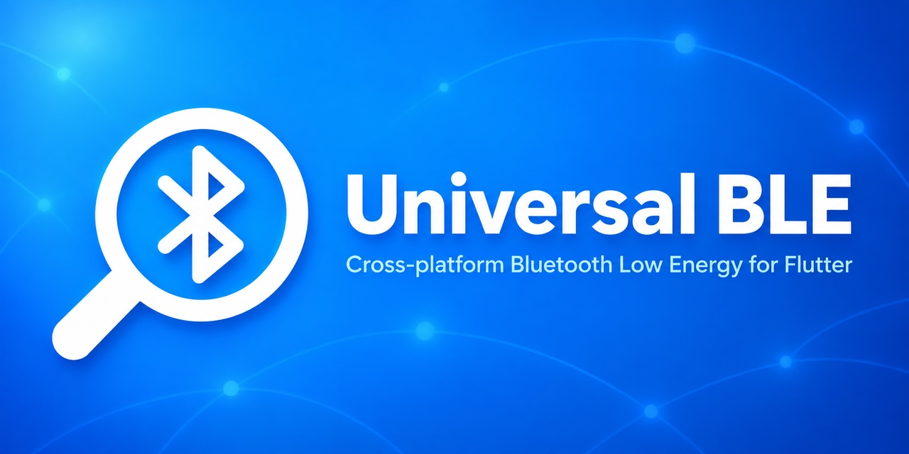

# Universal BLE

<div align="center">
  
</div>

[](https://pub.dev/packages/universal_ble)
[](https://opensource.org/licenses/BSD-3-Clause)
[](https://github.com/Navideck/universal_ble)
[](https://github.com/Navideck/universal_ble)
[](https://pub.dev/packages/universal_ble/score)
[](https://flutter.dev)
[](https://dart.dev)

A cross-platform (Android/iOS/macOS/Windows/Linux/Web) Bluetooth Low Energy (BLE) plugin for Flutter.

Looking for Bluetooth Classic? Check [universal_bluetooth_classic](https://pub.dev/packages/universal_bluetooth_classic).

> **Free**: This package is free for commercial or personal use as long as you adhere to the [BSD 3-Clause License](LICENSE).

[Try it online](https://navideck.github.io/universal_ble), provided your browser supports [Web Bluetooth](https://caniuse.com/web-bluetooth).

## Features

- [Scanning](#scanning)
- [Connecting](#connecting)
- [Discovering Services](#discovering-services)
- [Reading & Writing data](#reading--writing-data)
- [Pairing](#pairing)
- [Bluetooth Availability](#bluetooth-availability)
- [Requesting MTU](#requesting-mtu)
- [Reading RSSI](#reading-rssi)
- [Command Queue](#command-queue)
- [Timeout](#timeout)
- [Error Handling](#error-handling)
- [Device ID & UUID Formats](#device-id--uuid-formats)
- [Platform-specific setup](#platform-specific-setup)
- [Peripheral Mode](#peripheral-mode)
- [AI agent skills](#ai-agent-skills)

## API Support

**Legend:** ✔️ supported, — not supported, ⏺ partial support (see notes), 🚧 work in progress.

### Client Mode (`UniversalBle`)

|                               | Android | iOS | macOS | Windows | Linux | Web |
| :---------------------------- | :-----: | :-: | :---: | :-----: | :---: | :-: |
| startScan/stopScan            |   ✔️    | ✔️  |  ✔️   |   ✔️    |  ✔️   | ✔️  |
| connect/disconnect            |   ✔️    | ✔️  |  ✔️   |   ✔️    |  ✔️   | ✔️  |
| autoConnect                   |   ✔️    | ✔️  |  ✔️   |   —    |  —   | —  |
| getSystemDevices              |   ✔️    | ✔️  |  ✔️   |   ✔️    |  ✔️   | —  |
| discoverServices              |   ✔️    | ✔️  |  ✔️   |   ✔️    |  ✔️   | ✔️  |
| read                          |   ✔️    | ✔️  |  ✔️   |   ✔️    |  ✔️   | ✔️  |
| write                         |   ✔️    | ✔️  |  ✔️   |   ✔️    |  ✔️   | ✔️  |
| subscriptions                 |   ✔️    | ✔️  |  ✔️   |   ✔️    |  ✔️   | ✔️  |
| pair                          |   ✔️    | ✔️  |  ✔️   |   ✔️    |  ✔️   |  ⏺¹ |
| unpair                        |   ✔️    |  ⏺² |  —   |   ✔️    |  ✔️   | —  |
| isPaired                      |   ✔️    | ✔️  |  ✔️   |   ✔️    |  ✔️   | ✔️  |
| onPairingStateChange          |   ✔️    |  ⏺³ |  ⏺³  |   ✔️    |  ✔️   |  ⏺³ |
| getBluetoothAvailabilityState |   ✔️    | ✔️  |  ✔️   |   ✔️    |  ✔️   | —  |
| enable/disable Bluetooth      |   ✔️    | —  |  —   |   ✔️    |  ✔️   | —  |
| onAvailabilityChange          |   ✔️    | ✔️  |  ✔️   |   ✔️    |  ✔️   | ✔️  |
| requestMtu                    |   ✔️    | ✔️  |  ✔️   |   ✔️    |  ✔️   | —  |
| requestConnectionPriority     |   ✔️    | —  |  —   |   —    |  —   | —  |
| onConnectionParametersChange  |   ✔️    | —  |  —   |   —    |  —   | —  |
| readRssi                      |   ✔️    | ✔️  |  ✔️   |   —    |  🚧   | —  |
| requestPermissions            |   ✔️    | ✔️  |  ✔️   |   ✔️    |  ✔️   | ✔️  |

¹ On Web, `pair()` depends on the browser's host OS: ConfirmOnly ("Just Works") pairing can be triggered when the browser runs on macOS or Android, but not on Windows or Linux.

² On iOS, `unpair` only works for accessories authorized through AccessorySetupKit; other devices fail with `deviceNotFound`.

³ On iOS, macOS, and Web, events are driven by `pair()`: `true` when the encrypted-characteristic probe succeeds and `false` on failure. There is no system-initiated event and `unpair` does not report, so read the current state with `isPaired(pairingCommand:)`.

### Peripheral Mode (`UniversalBlePeripheral`)

| API                           | Android | iOS | macOS | Windows | Linux | Web |
| :---------------------------- | :-----: | :-: | :---: | :-----: | :---: | :-: |
| getCapabilities               |   ✔️    | ✔️  |  ✔️   |   ✔️    |  🚧   | —  |
| getAvailabilityState\*        |   ✔️    | ✔️  |  ✔️   |   ✔️    |  🚧   | —  |
| getAdvertisingState           |   ✔️    | ✔️  |  ✔️   |   ✔️    |  🚧   | —  |
| addService                    |   ✔️    | ✔️  |  ✔️   |   ✔️    |  🚧   | —  |
| removeService                 |   ✔️    | ✔️  |  ✔️   |   ✔️    |  🚧   | —  |
| clearServices                 |   ✔️    | ✔️  |  ✔️   |   ✔️    |  🚧   | —  |
| getServices                   |   ✔️    | ✔️  |  ✔️   |   ✔️    |  🚧   | —  |
| startAdvertising              |   ✔️    | ✔️  |  ✔️   |   ✔️    |  🚧   | —  |
| stopAdvertising               |   ✔️    | ✔️  |  ✔️   |   ✔️    |  🚧   | —  |
| updateCharacteristicValue\*\* |   ✔️    | ✔️  |  ✔️   |   ✔️    |  🚧   | —  |
| getSubscribedClients          |   ✔️    | ✔️  |  ✔️   |   ✔️    |  🚧   | —  |
| getMaximumNotifyLength        |   ✔️    | ✔️  |  ✔️   |   ✔️    |  🚧   | —  |
| event streams\*\*\*           |   ✔️    | ✔️  |  ✔️   |   ✔️    |  🚧   | —  |

\* `getAvailabilityState` returns a snapshot. Listen to `advertisingStateStream`, `connectionStateStream`, and related streams for runtime updates.

\*\* Pass `deviceId` to notify one client; omit it to notify all subscribed clients (when supported — see `getCapabilities().supportsTargetedCharacteristicUpdate`).

\*\*\* `advertisingStateStream`, `characteristicSubscriptionStream`, `connectionStateStream`, `serviceAddedStream`, `mtuChangedStream`, `subscribedCentralsStream`.

## Getting Started

Add universal_ble in your pubspec.yaml:

```yaml
dependencies:
  universal_ble:
```

and import it wherever you want to use it:

```dart
import 'dart:typed_data';
import 'package:universal_ble/universal_ble.dart';
```

> **Important**: Before using BLE features, make sure to check the [Permissions](#permissions) section to see what setup is needed for your target platform (Android, iOS, macOS, Windows, Linux, or Web).

### Scanning

The very first thing you need to do before being able to connect to a device is to discover it by calling `startScan();`

```dart
// Get scan updates from stream
UniversalBle.scanStream.listen((BleDevice bleDevice) {
  // e.g. Use BleDevice ID to connect
});

// Or set a handler
UniversalBle.onScanResult = (bleDevice) {}

// Perform a scan
UniversalBle.startScan();

// Or optionally add a scan filter
UniversalBle.startScan(
  scanFilter: ScanFilter(
    withServices: ["SERVICE_UUID"],
    withServiceData: ["SERVICE_DATA_UUID"],
    withManufacturerData: [ManufacturerDataFilter(companyIdentifier: 0x004c)],
    withNamePrefix: ["NAME_PREFIX"],
  )
);

// Stop scanning
UniversalBle.stopScan();

// Check if scanning
UniversalBle.isScanning();
```

Each scan result is a `BleDevice`. Besides `deviceId`, `name` and `rssi` it carries `services` (the advertised service UUIDs, normalised to full 128-bit lower-case UUIDs on every platform), `manufacturerDataList`, `serviceData` (the advertising Service Data payloads, keyed by service UUID), `connectable` and the reception timestamps.

#### Skipping duplicate scan results

By default every advertisement packet is reported, so the same device can show up many times per second — each one waking your app and drawing battery. Pass `skipDuplicates: true` to report each device only once per scan session: later sightings are suppressed until the scan is stopped (`UniversalBle.stopScan`) or the next `startScan`, including sightings whose advertisement payload changed.

```dart
UniversalBle.startScan(skipDuplicates: true);
```

Where a platform has a native lever it is applied so de-duplication happens before callbacks cross the platform channel, saving battery — iOS/macOS stop passing CoreBluetooth's allow-duplicates key, Android applies `CALLBACK_TYPE_FIRST_MATCH` on controllers that support offloaded first-match filtering when you supply an `AndroidOptions` (unless you set `callbackType` yourself), and Linux sets BlueZ' `DuplicateData` filter. On every platform the Dart layer de-duplicates as well, so the behavior is consistent everywhere. Defaults to `false` (every advertisement is reported, unchanged behavior); users who need live RSSI should keep it `false`.

On Web the browser's device chooser result is reported before advertisement packets arrive, so with `skipDuplicates: true` it is the only result for that device; advertisement-only fields such as RSSI and manufacturer data are not reported.

Before initiating a scan, ensure that Bluetooth is available:

```dart
AvailabilityState state = await UniversalBle.getBluetoothAvailabilityState();
// Start scan only if Bluetooth is powered on
if (state == AvailabilityState.poweredOn) {
  UniversalBle.startScan();
}

// Listen to bluetooth availability changes using stream
UniversalBle.availabilityStream.listen((state) {
  if (state == AvailabilityState.poweredOn) {
    UniversalBle.startScan();
  }
});

// Or set a handler
UniversalBle.onAvailabilityChange = (state) {};
```

See the [Bluetooth Availability](#bluetooth-availability) section for more.

#### System Devices

Already connected devices, connected either through previous sessions, other apps or through system settings, won't show up as scan results. You can get those using `getSystemDevices()`.

```dart
// Get already connected devices.
// You can set `withServices` to narrow down the results.
// On `Apple`, `withServices` is required to get any connected devices. If not passed, several [18XX] generic services will be set by default.
List<BleDevice> devices = await UniversalBle.getSystemDevices(withServices: []);
```

For each such device the `isSystemDevice` property will be `true`.

You still need to explicitly [connect](#connecting) to them before being able to use them.

#### Scan Filter

You can optionally set a filter when scanning. A filter can have multiple conditions (services, serviceData, manufacturerData, namePrefix) and all conditions are in `OR` relation, returning results that match any of the given conditions.

##### With Services

When setting this parameter, the scan results will only include devices that advertise any of the specified services.

```dart
List<String> withServices;
```

Note: On web **you have to** specify services before you are able to use them. See the [web](#web) section for more details.

##### With ServiceData

When setting this parameter, the scan results will only include devices that advertise **Service Data** for any of the specified services.

Service Data is the advertising data type that pairs a service UUID with a payload (`0x16`, `0x20` and `0x21` in the Bluetooth specification). It is a *different* field from the advertised service UUID list matched by `withServices`, and beacons commonly carry their UUID only there — Eddystone (`0xFEAA`), the ATC_MiThermometer (`0x181A`), BLE Mesh provisioning (`0x1827`) — which makes them invisible to a `withServices` filter.

```dart
List<String> withServiceData;
```

```dart
UniversalBle.startScan(
  scanFilter: ScanFilter(withServiceData: ['181A']),
);

UniversalBle.onScanResult = (device) {
  // The payload of the device's 181A Service Data field.
  final payload = device.serviceData['0000181a-0000-1000-8000-00805f9b34fb'];
};
```

UUIDs are accepted in any case and in short (`181A`), `0x`-prefixed, or full 128-bit form. Like the other conditions, an empty list is ignored and the conditions are in `OR` relation, so combining `withServiceData` with `withServices` returns devices matching either.

Platform notes:

- On `Android` and `Apple` this moves the scan to the software filter path: the platform cannot filter on Service Data (a controller-level scan filter, or `scanForPeripherals(withServices:)`, would discard the device before the plugin is notified), so more advertisements reach the app process at a battery cost. Set it only when you need it.
- On `Web` it is not supported and `startScan` / `requestDevice` throw `notSupported`: the browser's device chooser cannot filter on Service Data. Scan without it and read `BleDevice.serviceData` from the advertisement events instead.
- On `Android`, a peripheral using legacy BLE 4.x advertisements additionally needs `AndroidOptions(legacy: true)`.

##### With ManufacturerData

Use the `withManufacturerData` parameter to filter devices by manufacturer data. When you pass a list of `ManufacturerDataFilter` objects to this parameter, the scan results will only include devices that contain any of the specified manufacturer data.

You can filter manufacturer data by company identifier, payload prefix, or payload mask.

```dart
List<ManufacturerDataFilter> withManufacturerData = [ManufacturerDataFilter(
            companyIdentifier: 0x004c,
            payloadPrefix: Uint8List.fromList([0x001D,0x001A]),
            payloadMask: Uint8List.fromList([1,0,1,1]))
          ];
```

##### With namePrefix

Use the `withNamePrefix` parameter to filter devices by names (case sensitive). When you pass a list of names, the scan results will only include devices that have this name or start with the provided parameter.

```dart
List<String> withNamePrefix;
```

##### Connectable Only

Use the `connectableOnly` parameter to filter out non-connectable devices (such as beacons). When set to `true`, only connectable devices are included. Devices with unknown (`null`) connectability also pass this filter, so this option is a no-op on platforms that do not report connectability (Linux and Web, which always report `null`).

```dart
bool? connectableOnly;
```

##### Exclusion Filter

Use exclusion filters to exclude specific devices from scan results:

```dart
exclusionFilters: [
    ExclusionFilter(
      namePrefix: 'EXCLUDED_NAME',
      services: ['EXCLUDED_SERVICE_UUID'],
      manufacturerDataFilter: [ManufacturerDataFilter(companyIdentifier: 0x004c)],
    ),
]
```

### Connecting

#### Connect

Connects to the BLE device. This method initiates a connection to the Bluetooth device.

```dart
await bleDevice.connect();
```

#### Disconnect

Disconnects from the BLE device. This method terminates the connection to the Bluetooth device.

```dart
await bleDevice.disconnect();
```

#### Connection Stream

```dart
bleDevice.connectionStream.listen((isConnected) {
  debugPrint('Is device connected?: $isConnected');
});
```

To react to *why* a device disconnected, use `connectionChangeStream`. Each event carries the platform's error message, a unified `errorCode` (`UniversalBleErrorCode.deviceDisconnected` when the peripheral closed the link, `connectionTimeout` when the link was lost, `connectionFailed`, ...) and the raw `nativeErrorCode` (`CBError.Code` on Apple, the GATT status on Android; the numeric ranges overlap across platforms, so branch on `errorCode` and keep `nativeErrorCode` for logs). All three are usually `null` when the app requested the disconnect. Windows reports only the message; Linux and Web report `null` for all three.

```dart
bleDevice.connectionChangeStream.listen((change) {
  if (change.isConnected) return;
  switch (change.errorCode) {
    case UniversalBleErrorCode.deviceDisconnected: // peripheral closed the link
    case UniversalBleErrorCode.connectionTimeout:  // out of range / powered off
    default:
      debugPrint('Disconnected: ${change.errorCode} (native ${change.nativeErrorCode}) ${change.error}');
  }
});
```

#### IsConnected

```dart
bool isConnected = await bleDevice.isConnected;
```

#### Connection state

```dart
// Can be connected, disconnected, connecting or disconnecting
BleConnectionState connectionState = await bleDevice.connectionState;
```

#### Auto-connect

You can enable automatic reconnection by setting the `autoConnect` parameter to `true`. When enabled, the system will automatically attempt to reconnect to the device when it becomes available again.

```dart
await bleDevice.connect(autoConnect: true);
```

#### Background connection events (iOS/macOS)

By default, a suspended app does not get woken for connection events. Set `AppleConnectionOptions` to have the system alert the user and relaunch your app into the background when a connection event occurs while the app is suspended — e.g. to keep reacting to a previously paired peripheral (auto-reconnect) during a workout while the phone is locked. Requires the `bluetooth-central` background mode on iOS.

Note: the system may show an alert to the user for these events, and `notifyOnNotification` fires per characteristic notification, so enable only what you need.

```dart
await bleDevice.connect(
  autoConnect: true,
  platformConfig: ConnectionPlatformConfig(
    apple: AppleConnectionOptions(
      notifyOnConnection: true,
      notifyOnDisconnection: true,
      notifyOnNotification: true,
    ),
  ),
);
```

#### Close GATT on app teardown (Android)

When the Android app is killed by the user (typically swiped away from recents), the OS tears down the FlutterEngine without ever delivering a "disconnect" — the peripheral keeps the link open until its connection supervision timeout (often 10–20 s), leaving the device occupied.

Pass `AndroidConnectionOptions(closeGattOnDetach: true)` to have the plugin close every GATT client this engine owns as soon as the engine detaches, releasing the peripheral immediately. Without the option, whatever the `autoConnect` value, the link persists until the peripheral's supervision timeout.

```dart
await bleDevice.connect(
  autoConnect: true,
  platformConfig: ConnectionPlatformConfig(
    android: AndroidConnectionOptions(closeGattOnDetach: true),
  ),
);
```

Notes:
- The option is scoped to the engine that sets it: on teardown, that engine releases the clients it created, leaving clients owned by other engines (for example a background engine's live link) untouched. To have a background engine release the peripherals it connected, that engine must connect with `closeGattOnDetach: true` as well — setting the option on the UI engine does not cover the background engine's clients. It can be disabled at runtime by connecting with `closeGattOnDetach: false`; connecting without the option leaves the engine's current value unchanged (a fresh app launch resets it).
- Android-only. Explicit `disconnect()` calls and rotation are unaffected.

#### Native device picker (Web, iOS 18+)

`requestDevice` presents the platform's native device picker and returns the
device the user selected. Connect it through the normal path:

- **Web:** opens the browser's Bluetooth device chooser, honoring the scan
  filter. Call `requestDevice` from a user gesture (for example a button tap);
  browsers reject the chooser otherwise.
- **iOS 18+:** shows Apple's AccessorySetupKit picker to select and authorize a
  nearby accessory. The scan filter is ignored here; discovery is described by
  the Apple options below.

```dart
final device = await UniversalBle.requestDevice(
  // Web: the browser chooser honors the scan filter.
  scanFilter: ScanFilter(withServices: ['180D']),
  platformConfig: PickerPlatformConfig(
    // iOS 18+.
    apple: AppleAccessorySetupOptions(
      items: [
        AppleAccessoryPickerItem(
          displayName: 'My Device',
          imageAsset: 'my_device', // Image in Runner/Assets.xcassets
          serviceUuid: '12345678-1234-1234-1234-1234567890AB',
          nameSubstring: 'MyDevice', // Optional
        ),
      ],
    ),
  ),
);

await UniversalBle.connect(device.deviceId);

// iOS: removes an accessory authorized through AccessorySetupKit.
await UniversalBle.unpair(device.deviceId);
```

The AccessorySetupKit picker must be initiated while the app is in the
foreground. Add matching values to the iOS app's `Info.plist`; Apple terminates
apps that show the picker with undeclared discovery identifiers:

```xml
<key>NSAccessorySetupKitSupports</key>
<array>
  <string>Bluetooth</string>
</array>
<key>NSAccessorySetupBluetoothServices</key>
<array>
  <string>12345678-1234-1234-1234-1234567890AB</string>
</array>
<key>NSAccessorySetupBluetoothNames</key>
<array>
  <string>MyDevice</string>
</array>
```

When the app uses AccessorySetupKit exclusively, it does not need
`NSBluetoothAlwaysUsageDescription`. Keep that key if the app also uses regular
BLE scanning or accesses devices outside AccessorySetupKit.

### Discovering Services

After establishing a connection, services need to be discovered. This method will discover all services and their characteristics.

If you don't call this method then it will be automatically called when you try to get any service or characteristic.

#### DiscoverServices

Discovers the services offered by the device. Returns a `Future<List<BleService>>`. After discovery services are cached and each call of this method updates the cache.

```dart
List<BleService> services = await bleDevice.discoverServices();
for (var service in services) {
  debugPrint('Service UUID: ${service.uuid}');
}
```

Android keeps its own GATT cache across connections. If the peripheral's GATT layout changed while it was disconnected (typical during firmware development) and it does not send a Service Changed indication, discovery keeps returning the old layout. Pass `AndroidDiscoverServicesOptions(clearGattCache: true)` to drop that cache (`BluetoothGatt.refresh()`) right before discovering. The option is ignored on other platforms, where the OS cache is only invalidated by Service Changed.

```dart
List<BleService> services = await bleDevice.discoverServices(
  platformConfig: DiscoverServicesPlatformConfig(
    android: AndroidDiscoverServicesOptions(clearGattCache: true),
  ),
);
```

On iOS and macOS a discovery that has not completed after 10 seconds fails, so that it cannot hold back later calls for the same device. A `timeout` passed to `discoverServices`, or a global `UniversalBle.timeout` above 10 seconds, extends that, for a peripheral that is slow to answer; on the other platforms it is the only limit. `AppleDiscoverServicesOptions(timeoutMillis: ...)` sets the iOS and macOS limit directly, and without a `timeout` it bounds the whole call too.

```dart
List<BleService> services = await bleDevice.discoverServices(
  timeout: const Duration(seconds: 30),
);
```

#### GetService

Retrieves a specific service. Returns a `Future<BleService>`.

- `service`: The UUID of the service.
- `preferCached`: If `true` (default), cached services are used. If cache is empty, `discoverServices()` will be called.

```dart
BleService service = await bleDevice.getService('180a');
```

#### GetCharacteristic

Retrieves a specific characteristic from a service. Returns a `Future<BleCharacteristic>`.

- `service`: The UUID of the service.
- `characteristic`: The UUID of the characteristic.
- `preferCached`: If `true` (default), cached services are used. If cache is empty, `discoverServices()` will be called

```dart
BleCharacteristic characteristic = await bleDevice.getCharacteristic('180a','2a56');
```

Or retrieve from `BleService`

```dart
BleCharacteristic characteristic = await service.getCharacteristic('2a56');
```

## Reading & Writing data

You need to first [discover services](#discovering-services) before you are able to read and write to characteristics.

### Reading data

```dart
Uint8List value = await characteristic.read();
```

To make it more convenient, you can use built-in extensions on `Future<Uint8List>` or `Uint8List` to parse numbers, strings, and hex directly:

```dart
// Numbers (8, 16, 32-bit signed/unsigned, floats), little-endian by default
int batteryLevel = await characteristic.read().toUint8();
int heartRate    = await characteristic.read().toUint16(); 
int counter      = await characteristic.read().toInt32();
double temp      = await characteristic.read().toFloat32();

// Custom endianness and byte offset for multi-field packets
int sensorValue  = await characteristic.read().toUint16(offset: 2, endian: Endian.big);

// Strings (Device Name, Serial Number, etc.)
String deviceName = await characteristic.read().toUtf8();

// Hex string for debugging (e.g. "01:0a:ff" or "010AFF")
String hexDump = await characteristic.read().toHexString(separator: ':');
```

The same extensions work on any `Uint8List` (e.g., from `characteristic.onValueReceived` notifications):

```dart
characteristic.onValueReceived.listen((bytes) {
  int flags = bytes.toUint8();
  int sensorReading = bytes.toUint16(offset: 1);
  print('Hex payload: ${bytes.toHexString()}');
});
```

### Writing data

```dart
await characteristic.write([0x01, 0x02, 0x03]);

await characteristic.write([0x01, 0x02, 0x03], withResponse: false);
```

To read or write a descriptor of this characteristic

```dart
Uint8List value = await characteristic.descriptor('2901').read();
```

```dart
await characteristic.descriptor('2901').write([0x01, 0x02, 0x03]);
```

## Subscriptions

Get `BleCharacteristic` using `bleDevice.getCharacteristic`

### OnValueReceived

A stream of `Uint8List` that emits values received from the characteristic. Listen to this stream to receive updates whenever the characteristic's value changes.

```dart
characteristic.onValueReceived.listen((value) {
  debugPrint('Received value: ${value.toString()}');
});
```

### Notifications

Subscribe to notifications for this characteristic. Throws an exception if the characteristic does not support notifications.

```dart
await characteristic.notifications.subscribe();
```

### Indications

Subscribe to indications for this characteristic. Throws an exception if the characteristic does not support indications.

```dart
await characteristic.indications.subscribe();
```

### Unsubscribe

Unsubscribe from notifications and indications of this characteristic.

```dart
await characteristic.unsubscribe();
```

### Check Subscription Status

Check if a characteristic is currently subscribed to:

```dart
// Via BleCharacteristic or CharacteristicSubscription
bool isSubscribed = characteristic.isSubscribed;
// or
bool isSubscribed = characteristic.notifications.isSubscribed;

// Or globally via UniversalBle
bool isSubscribed = UniversalBle.isSubscribed(deviceId, characteristicId);

// Get all subscribed characteristic UUIDs for a device
List<String> subscribedChars = UniversalBle.getSubscribedCharacteristics(deviceId);
```

### Pairing

#### Trigger pairing

##### Pair on Android, Windows, Linux

```dart
await bleDevice.pair();
```

##### Pair on Apple and web

For Apple and Web, pairing support depends on the device. Pairing is triggered automatically by the OS when you try to read/write from/to an encrypted characteristic.

Calling `bleDevice.pair()` will only trigger pairing if the device has an _encrypted read characteristic_.

If your device only has encrypted write characteristics or you happen to know which encrypted read characteristic you want to use, you can pass it with a `pairingCommand`.

```dart
await bleDevice.pair(pairingCommand: BleCommand(service:"SERVICE", characteristic:"ENCRYPTED_CHARACTERISTIC"));
```

After pairing you can check the pairing status.

#### Pairing status

##### Pair on Android, Windows, Linux

```dart
// Check current pairing state
bool? isPaired = bleDevice.isPaired();
```

##### Pair on Apple and web

For `Apple` and `Web`, you have to pass a "pairingCommand" with an encrypted read or write characteristic. If you don't pass it then it will return `null`.

```dart
bool? isPaired = await bleDevice.isPaired(pairingCommand: BleCommand(service:"SERVICE", characteristic:"ENCRYPTED_CHARACTERISTIC"));
```

##### Discovering encrypted characteristic

To discover encrypted characteristics, make sure your device is not paired and use the example app to read/write to all discovered characteristics one by one. If one of them triggers pairing, that means it is encrypted and you can use it to construct `BleCommand(service:"SERVICE", characteristic:"ENCRYPTED_CHARACTERISTIC")`.

#### Pairing state changes

```dart
// Get pairing state updates using stream
bleDevice.pairingStateStream.listen((bool paired) {
  // Handle pairing state change
});
```

On `Apple` and `Web`, see note ³ in [API Support](#api-support).

#### Unpair

```dart
bleDevice.unpair();
```

### Bluetooth Availability

```dart
// Get current Bluetooth availability state
AvailabilityState availabilityState = UniversalBle.getBluetoothAvailabilityState(); // e.g. poweredOff or poweredOn,

// Receive Bluetooth availability changes
UniversalBle.onAvailabilityChange = (state) {
  // Handle the new Bluetooth availability state
};

// Enable Bluetooth programmatically
UniversalBle.enableBluetooth();

// Disable Bluetooth programmatically
UniversalBle.disableBluetooth();
```

### Requesting MTU

```dart
int mtu = await bleDevice.requestMtu(256);
```

> ⚠️ Note: Requesting an MTU is a _best-effort_ operation.
> On many platforms the final MTU is fully controlled by the OS and remote device.

> 📋 On iOS/macOS and Linux the device's services are discovered on demand
> first, because the reported MTU is only meaningful once they are known (on
> iOS/macOS CoreBluetooth otherwise reports the default ATT MTU, 23, as if it
> were the negotiated value). Calling `discoverServices()` yourself first is
> optional — it is skipped when the services are already discovered.

#### Platform Limitations

MTU negotiation is largely platform- and stack-managed, and often cannot be
explicitly controlled by applications:

- **iOS / macOS**

  - MTU is fully OS-managed; apps cannot request or set it.
  - Historically ~185 bytes, but modern devices may negotiate larger MTUs
    (≈247–517) automatically.

- **Android**

  - **Android ≤ 13**: Apps may request MTU once per connection (up to 517).
    If never requested, the default MTU is 23.
  - **Android 14+**: The first Bluetooth client effectively drives MTU negotiation
    to 517 (or the link’s maximum); subsequent MTU requests are ignored.

- **Windows**

  - MTU is automatically negotiated by the OS.
  - Apps cannot set it; they can only query the effective PDU size.

- **Linux (BlueZ)**

  - MTU is negotiated automatically by default.
  - The standard D-Bus Bluetooth API does not expose MTU control.
  - MTU can be requested via BlueZ tools or lower-level APIs, but most apps
    treat it as stack-defined.

- **Web**

  - MTU is negotiated internally by the browser/OS.
  - No API exists to query or modify the MTU size.

#### Best Practices

When developing cross-platform BLE applications and devices:

- Always design for the default ATT MTU (23 bytes)
- Treat MTU requests as opportunistic, not guaranteed
- Dynamically adapt packet sizes based on the negotiated MTU
- Implement application-level fragmentation for larger payloads
- Take advantage of higher MTUs when available, without depending on them

### Requesting Connection Priority

On Android, you can request a connection parameter update to tune the BLE connection interval. This can yield a 3–7× throughput improvement for data-intensive transfers.

```dart
// Before starting high-throughput data transfer:
await UniversalBle.requestConnectionPriority(
  deviceId,
  BleConnectionPriority.highPerformance,
);
```

> **Note:** Only supported on Android. On all other platforms this throws `UniversalBleException` with code `notSupported`.
> Call this after connecting and after `requestMtu()`, before beginning data transfer.

The OS may later change connection parameters without your app requesting it (e.g. for power saving), which can reduce throughput. On Android API 26+, set `UniversalBle.onConnectionParametersChange` and react if needed:

```dart
UniversalBle.onConnectionParametersChange = (update) {
  if (update.deviceId != deviceId || !update.isSuccess) return;
  // Prefer intervalMs for throughput decisions; estimatedPriority is approximate.
  if (update.intervalMs > 50) {
    UniversalBle.requestConnectionPriority(
      deviceId,
      BleConnectionPriority.highPerformance,
    );
  }
};
```

> **Note:** Re-requesting high priority on every update can fight the OS power manager — debounce in app code. Requires Android API 26+ (`BleCapabilities.supportsConnectionParametersUpdates`).

### Reading RSSI

Read the signal strength (RSSI) of a connected device.

```dart
int rssi = await bleDevice.readRssi();
```

> ⚠️ Note: The device must be connected before reading RSSI.

#### Platform Limitations

- **Android / iOS / macOS**: Fully supported.

- **Windows / Linux / Web**: Not supported.

## Command Queue

By default, commands use `QueueType.auto`, which automatically picks the best strategy for the current platform with zero configuration. Android, Web, and Linux use a per-device queue (their BLE stacks reject or misbehave on overlapping operations), while all other platforms run commands in parallel (they pipeline natively).

If you want explicit control over how commands are serialized, you can set `queueType`:

```dart
// Run all commands in a single global queue (safest, but slower).
UniversalBle.queueType = QueueType.global;

// Create a separate queue for each device.
UniversalBle.queueType = QueueType.perDevice;

// Auto-decide per platform (default): Android, Web and Linux queue per device, others run in parallel.
UniversalBle.queueType = QueueType.auto;
```

You can have separate queues by passing an optional `queueId`. Commands with the same `queueId` are serialized together, but run in parallel with both `QueueType.perDevice` and `QueueType.global`:

```dart
UniversalBle.write(deviceId, service, char, value1, queueId: '1');
UniversalBle.write(deviceId, service, char, value2, queueId: '2');
```

You can also completely disable the queue and batch all commands, even for the same device, by using:

```dart
// Disable queue
UniversalBle.queueType = QueueType.none;
```

Keep in mind that some platforms (e.g. Android) may not handle well devices that fail to process consecutive commands without a minimum interval. Therefore, it is not advised to set `queueType` to `none`.

You can get queue updates by setting:

```dart
// Get queue state updates
UniversalBle.onQueueUpdate = (String id, int remainingItems) {
  debugPrint("Queue: $id Remaining: $remainingItems");
};
```

To clear a queue:

```dart
// Clear global queue
UniversalBle.clearQueue(BleCommandQueue.globalQueueId);

// Clear a per-device queue (when queueType is perDevice)
UniversalBle.clearQueue(deviceId);

// Clear a custom queue (same string passed as queueId to read/write/etc.)
UniversalBle.clearQueue('customQueueId');

// Clear all queues
UniversalBle.clearQueue();
```

### Peripheral Command Queue

`UniversalBlePeripheral` supports the same queueing configuration (`queueType`, `timeout`, `clearQueue`, and `onQueueUpdate`) for peripheral commands (e.g. `addService`, `startAdvertising`, `updateCharacteristicValue`):

```dart
// Configure peripheral command queue (defaults to QueueType.auto)
UniversalBlePeripheral.queueType = QueueType.perDevice;

// Clear peripheral queue
UniversalBlePeripheral.clearQueue(deviceId);

// Send peripheral updates with a specific queueId
UniversalBlePeripheral.updateCharacteristicValue(
  characteristicId: charUuid,
  value: data,
  deviceId: deviceId,
  queueId: 'customQueueId',
);
```

## Timeout

By default, all commands have a global timeout of 10 seconds.

```dart
// Change timeout
UniversalBle.timeout = const Duration(seconds: 10);

// Disable timeout
UniversalBle.timeout = null;
```

You can also specify the `timeout` parameter when sending a command. This will override the global timeout.

## Error Handling

Universal BLE provides a unified and type-safe error handling system across all platforms. All errors are represented using the `UniversalBleException` base class with typed error codes from the `UniversalBleErrorCode` enum.

### Exception Types

- **`UniversalBleException`**: Base exception class for all BLE errors
- **`ConnectionException`**: Thrown for connection-related errors
- **`PairingException`**: Thrown for pairing-related errors
- **`WebBluetoothGloballyDisabled`**: Thrown when Web Bluetooth is globally disabled

### Error Codes

All errors are categorized using the `UniversalBleErrorCode` enum, which includes codes for:

- Connection errors (timeout, failed, rejected, etc.)
- Pairing errors (failed, cancelled, not allowed, etc.)
- Operation errors (not supported, timeout, cancelled, etc.)
- Permission errors (not allowed, unauthorized, access denied, etc.)
- Device errors (not found, disconnected, etc.)
- Service/Characteristic errors (not found, invalid UUID, etc.)
- And many more...

### Usage

```dart
try {
  await bleDevice.connect();
} on ConnectionException catch (e) {
  // Handle connection-specific errors
  switch (e.code) {
    case UniversalBleErrorCode.connectionTimeout:
      // Handle timeout
      break;
    case UniversalBleErrorCode.connectionFailed:
      // Handle connection failure
      break;
    case UniversalBleErrorCode.deviceDisconnected:
      // Handle disconnection
      break;
    default:
      // Handle other connection errors
  }
} on UniversalBleException catch (e) {
  // Handle other BLE errors
  print('Error code: ${e.code}, Message: ${e.message}');
}
```

The error parser automatically converts platform-specific error formats (strings, numeric codes, PlatformExceptions) into the unified `UniversalBleErrorCode` enum, ensuring consistent error handling across all platforms.

When a peripheral refuses a characteristic or descriptor read/write, or a subscription, Android, Apple and Windows report the ATT error as the matching `UniversalBleErrorCode` (`insufficientEncryption`, `insufficientAuthentication`, `readNotPermitted`, ...) instead of a generic `failed`/`unknownError`. The raw native code is available in `UniversalBleException.details`. Service/characteristic discovery at connect time, and the Linux and Web backends, may still report a generic code.

## Peripheral Mode

`universal_ble` provides peripheral mode through `UniversalBlePeripheral`, so your app can advertise as a peripheral "server" in addition to client mode.

### Setup

```dart
import 'package:universal_ble/universal_ble.dart';

final caps = await UniversalBlePeripheral.getCapabilities();
if (!caps.supportsPeripheralMode) return;

final readiness = await UniversalBlePeripheral.getAvailabilityState();
if (readiness != PeripheralReadinessState.ready) return;
```

### Service Management

Peripheral GATT services use `BlePeripheralService`, `BlePeripheralCharacteristic`, and `BlePeripheralDescriptor`. Each characteristic requires `permissions`; descriptors can include an initial `value` (for example HID Report Reference `0x2908`).

```dart
import 'package:universal_ble/universal_ble.dart';

const batteryService = '0000180f-0000-1000-8000-00805f9b34fb';
const batteryLevelChar = '00002a19-0000-1000-8000-00805f9b34fb';
const heartRateService = '0000180d-0000-1000-8000-00805f9b34fb';
const heartRateChar = '00002a37-0000-1000-8000-00805f9b34fb';

await UniversalBlePeripheral.addService(
  BlePeripheralService(
    uuid: batteryService,
    primary: true,
    characteristics: [
      BlePeripheralCharacteristic(
        uuid: batteryLevelChar,
        properties: [
          CharacteristicProperty.read,
          CharacteristicProperty.notify,
        ],
        permissions: [
          PeripheralAttributePermission.readable,
          PeripheralAttributePermission.writeable,
        ],
        descriptors: [
          BlePeripheralDescriptor(uuid: '00002902-0000-1000-8000-00805f9b34fb'),
        ],
      ),
    ],
  ),
);

// A characteristic that appears more than once in a service: give each
// instance a stable identity and address it by that identity.
await UniversalBlePeripheral.addService(
  BlePeripheralService(
    uuid: '00001812-0000-1000-8000-00805f9b34fb',
    characteristics: [
      BlePeripheralCharacteristic(
        uuid: '00002a4d-0000-1000-8000-00805f9b34fb',
        instanceId: 'consumerInput',
        properties: [CharacteristicProperty.notify],
        permissions: [PeripheralAttributePermission.readable],
      ),
    ],
  ),
);

await UniversalBlePeripheral.updateCharacteristicValue(
  characteristicId: '00002a4d-0000-1000-8000-00805f9b34fb',
  instanceId: 'consumerInput',
  value: Uint8List.fromList([0xE9, 0x00]),
);

await UniversalBlePeripheral.addService(
  BlePeripheralService(
    uuid: heartRateService,
    characteristics: [
      BlePeripheralCharacteristic(
        uuid: heartRateChar,
        properties: [
          CharacteristicProperty.read,
          CharacteristicProperty.notify,
          CharacteristicProperty.write,
        ],
        permissions: [
          PeripheralAttributePermission.readable,
          PeripheralAttributePermission.writeable,
        ],
      ),
    ],
  ),
);

final services = await UniversalBlePeripheral.getServices();
await UniversalBlePeripheral.removeService(heartRateService);
await UniversalBlePeripheral.clearServices();
```

### Advertising

On **Android**, passing `localName` may temporarily change the system Bluetooth device name (so it can appear in the advertisement). The plugin restores the previous name when advertising stops, if starting advertising fails, or when the plugin is disposed.

On **Windows**, pass `services: []` and `manufacturerData` for connectionless advertising via `BluetoothLEAdvertisementPublisher`. No GATT service registration is needed. The company ID must fit 16 bits and the payload must be at most 27 bytes (legacy advertising). Stop advertising before changing the payload. Registered-service advertising still uses `GattServiceProvider`; combining service UUIDs with manufacturer data is not supported. Windows does not allow a custom `localName` in either mode. Unsupported combinations return `not-supported`. Advertising is best effort; listen to `advertisingStateStream` for asynchronous failures. See [Microsoft's publisher restrictions](https://learn.microsoft.com/en-us/uwp/api/windows.devices.bluetooth.advertisement.bluetoothleadvertisementpublisher).

On **iOS/macOS**, CoreBluetooth supports local names and service UUIDs, not manufacturer data. `getCapabilities()` reflects this restriction. Use a local-name carrier when your protocol must also broadcast on Apple platforms.

```dart
import 'dart:typed_data';
import 'package:flutter/foundation.dart';
import 'package:universal_ble/universal_ble.dart';

// Uses batteryService from Service Management above.
final isWindows = !kIsWeb && defaultTargetPlatform == TargetPlatform.windows;
final caps = await UniversalBlePeripheral.getCapabilities();

await UniversalBlePeripheral.startAdvertising(
  services: [batteryService],
  localName: isWindows ? null : 'UniversalBlePeripheral',
  manufacturerData: isWindows || !caps.supportsManufacturerDataInAdvertisement
      ? null
      : ManufacturerData(
          0x012d,
          Uint8List.fromList([0x03, 0x00, 0x64, 0x00]),
        ),
  platformConfig: PeripheralPlatformConfig(
    android: PeripheralAndroidOptions(
      addManufacturerDataInScanResponse: false,
    ),
  ),
);

final advertisingState = await UniversalBlePeripheral.getAdvertisingState();
if (advertisingState == PeripheralAdvertisingState.advertising) {
  // Peripheral is advertising.
}

await UniversalBlePeripheral.stopAdvertising();
```

### Request Handlers

Register read/write handlers separately. Return `null` to let the stack use the characteristic's configured or per-client value (including a CCCD, which is tracked per client and defaults to disabled).

Read handlers return the **complete** characteristic value: the platform applies the client's read offset exactly once, on every platform.

On Apple platforms, a multi-request write batch is rejected with `requestNotSupported` before invoking any write handler. CoreBluetooth requires atomic batch handling, but these individual-write callbacks cannot validate or roll back a whole batch. Single-request writes retain their normal handler behavior.

When a service contains several characteristics with the same UUID (HID Report characteristics), set `instanceId` on each and use the `...WithInstance` variants. They receive the instance identity; the UUID-only handlers above keep receiving the first matching characteristic.

```dart
import 'dart:typed_data';
import 'package:universal_ble/universal_ble.dart';

UniversalBlePeripheral.setReadRequestHandlers(
  (deviceId, characteristicId, offset, value) {
    return PeripheralReadRequestResult(
      value: value ?? Uint8List(0),
    );
  },
);

UniversalBlePeripheral.setWriteRequestHandlers(
  (deviceId, characteristicId, offset, value) {
    return PeripheralWriteRequestResult();
  },
);

UniversalBlePeripheral.setDescriptorReadRequestHandlers(
  (deviceId, characteristicId, descriptorId, offset, value) {
    return PeripheralReadRequestResult(
      value: value ?? Uint8List(0),
    );
  },
);

UniversalBlePeripheral.setDescriptorWriteRequestHandlers(
  (deviceId, characteristicId, descriptorId, offset, value) {
    return PeripheralWriteRequestResult();
  },
);

// Instance-aware variant, for services with duplicate characteristic UUIDs.
UniversalBlePeripheral.setReadRequestHandlersWithInstance(
  (deviceId, characteristicId, instanceId, offset, value) {
    return null;
  },
);
```

### Characteristic Updates

```dart
import 'dart:typed_data';
import 'package:universal_ble/universal_ble.dart';

await UniversalBlePeripheral.updateCharacteristicValue(
  characteristicId: batteryLevelChar,
  value: Uint8List.fromList([92]),
);

// Notify one client (when getCapabilities().supportsTargetedCharacteristicUpdate).
await UniversalBlePeripheral.updateCharacteristicValue(
  characteristicId: batteryLevelChar,
  value: Uint8List.fromList([88]),
  deviceId: deviceId,
);
```

### Subscribed Clients and Notify Length

Useful to restore in-app state after a process restart (subscription callbacks are not replayed).

```dart
import 'package:universal_ble/universal_ble.dart';

final subscribers = await UniversalBlePeripheral.getSubscribedClients(
  batteryLevelChar,
);

for (final deviceId in subscribers) {
  final maxNotifyLength =
      await UniversalBlePeripheral.getMaximumNotifyLength(deviceId);
  // maxNotifyLength is null when unknown for this device.
}
```

### Event Streams

```dart
import 'package:universal_ble/universal_ble.dart';

UniversalBlePeripheral.advertisingStateStream.listen(
  (BlePeripheralAdvertisingStateChanged event) {
    // event.state, event.error
  },
);

UniversalBlePeripheral.characteristicSubscriptionStream.listen(
  (BlePeripheralCharacteristicSubscriptionChanged event) {
    // event.deviceId, event.characteristicId, event.isSubscribed, event.name
  },
);

UniversalBlePeripheral.connectionStateStream.listen(
  (BlePeripheralConnectionStateChanged event) {
    // event.deviceId, event.connected
  },
);

UniversalBlePeripheral.serviceAddedStream.listen(
  (BlePeripheralServiceAdded event) {
    // event.serviceId, event.error
  },
);

UniversalBlePeripheral.mtuChangedStream.listen(
  (BlePeripheralMtuChanged event) {
    // event.deviceId, event.mtu
  },
);
```

### Tracking Subscribed Centrals

To track connected BLE central devices currently subscribed to characteristics on your peripheral:

```dart
import 'package:universal_ble/universal_ble.dart';

// Stream of active centrals (emits current list upon listen, and updates on subscribe/unsubscribe/disconnect)
UniversalBlePeripheral.subscribedCentralsStream.listen((List<BleCentral> centrals) {
  for (final central in centrals) {
    print('Central ID: ${central.id}, Name: ${central.name}');
    print('Subscribed characteristics: ${central.subscribedCharacteristics}');
  }
});

// Synchronous snapshot
final List<BleCentral> activeCentrals = UniversalBlePeripheral.subscribedCentrals;
```

### Platform notes

- Linux/Web currently return unsupported for peripheral mode.
- Windows peripheral advertising does not expose all advertising payload customization options from Android/Apple stacks.
- **Central tracking on iOS / Apple platforms**: CoreBluetooth's `CBPeripheralManager` does not expose generic link-layer connection/disconnection callbacks for peripherals. Centrals are tracked as active when they subscribe to at least one GATT characteristic (`didSubscribeTo`), and are removed only when unsubscribed from all characteristics via `didUnsubscribeFrom`. Because CoreBluetooth does not guarantee unsubscription callbacks on abrupt link-layer disconnects, an entry may linger until the next unsubscription or until services are cleared. Other platforms (such as Android) additionally prune tracked centrals immediately on link-layer disconnection.
- iOS/macOS setup (including required `Info.plist` keys for peripheral usage) is documented in [Permissions → iOS / macOS](#ios--macos).

### Apple peripheral reliability and restoration

For dynamic characteristics (write, notify, or indicate), CoreBluetooth requires
`value: nil` at native construction. The plugin retains configured initial values
for fallback reads; an installed read handler supplies current values.
Set `BlePeripheralCharacteristic(requireEncryptedNotifications: true, ...)` to
require encrypted notification subscriptions on Apple. The setting defaults to
false and is ignored on other platforms.

Install request handlers and subscription/connection listeners before calling:

```dart
await UniversalBlePeripheral.configureRestoration('com.example.app.peripheral');
```

For early manager recreation after an OS relaunch, configure the same identifier
in the host application's Info.plist and add the iOS background mode:

```xml
<key>UniversalBlePeripheralRestorationIdentifier</key>
<string>com.example.app.peripheral</string>
<key>UIBackgroundModes</key>
<array><string>bluetooth-peripheral</string></array>
```

Early recreation requires existing Bluetooth permission, so adding this key does
not introduce a launch-time permission prompt. Each engine must use a distinct
restoration identifier; the Info.plist key belongs to the first engine that claims
it. Other engines may configure their own identifier before manager creation.
Restored native services and characteristics are reused. Re-add their matching
Dart service definitions to bind instance IDs and initial fallback values and
retain definitions for later adapter recovery. A changed layout must be removed
before replacement. Install listeners before configuration, then query
`getSubscribedClients` to reconcile readiness. Explicit force-quit recovery and
background discoverability are governed by CoreBluetooth and are not guaranteed.

Apple notifications remain FIFO while CoreBluetooth applies backpressure. Use
`await UniversalBlePeripheral.clearPendingNotifications(deviceId)` at an explicit
session boundary or suspension to discard unsent updates, then publish neutral
state before new input. Native unsubscription, service removal, and adapter loss
also invalidate pending Apple updates. Packets already accepted by the OS cannot
be recalled. Completion of `updateCharacteristicValue` means accepted by the
plugin, not acknowledged by the remote device.

Run `./darwin/test/run_peripheral_reliability_tests.sh` on macOS for native
characteristic, restored-identity, and notification-FIFO regression checks.


## Device ID & UUID Formats

Universal BLE normalises identifiers across platforms so you don't need to worry about underlying platform differences:

### Device IDs

- **Android, iOS, macOS, Windows, Linux:** Device IDs (MAC addresses or Apple UUIDs) are normalised to **lower-case**, so IDs can be compared with plain string equality, and a `deviceId` can be passed in upper, lower, or mixed case to any `UniversalBle` or `UniversalBlePeripheral` method.
- **Web (exception):** Device IDs are opaque, case-sensitive browser tokens, preserved verbatim and must be matched with exact case.

```dart
// Native IDs are normalised to lower-case, so IDs compare with plain string equality:
UniversalBle.onScanResult = (BleDevice device) {
  print(device.deviceId); // e.g. "aa:bb:cc:dd:ee:ff" or "e621e1f8-c36c-495a-93fc-0c247a3e6e5f"
};

// Any case is accepted when calling APIs:
await UniversalBle.connect("AA:BB:CC:DD:EE:FF");
await UniversalBle.connect("aa:bb:cc:dd:ee:ff");
await UniversalBle.connect("Aa:Bb:Cc:Dd:Ee:Ff");
```

```dart
// Web (exception) — opaque, case-sensitive tokens, matched exactly as emitted:
UniversalBle.onScanResult = (BleDevice device) {
  print(device.deviceId); // e.g. "rNvoULy2kW0atVQmwH8WYg==" (not a MAC or UUID)
};

await UniversalBle.connect(webDeviceId); // must match exactly — never re-cased
```

IDs that Universal BLE returns are already in this form, so plain string equality works for them. If you compare a device ID that came from elsewhere (for example one you stored yourself) or use IDs as map keys across sources, `UniversalBle.canonicalDeviceId(deviceId)` returns the comparable form for the current platform (lower-case on native, verbatim on Web):

```dart
// An id from your own storage may be in a different case than the emitted one.
final key = UniversalBle.canonicalDeviceId(storedDeviceId);
```

### UUIDs

Universal BLE is agnostic to the UUID format of services and characteristics:
- You can pass UUIDs in any format (16-bit, 32-bit, 128-bit) and any character case.
- All characteristic and service UUIDs are returned in **lowercase 128-bit format** across all platforms, e.g. `0000180a-0000-1000-8000-00805f9b34fb`.

### Utility Methods

If you need to convert any UUIDs in your app you can use the following methods.

- `BleUuidParser.string()` converts a string to a 128-bit UUID formatted string:

```dart
BleUuidParser.string("180A"); // "0000180a-0000-1000-8000-00805f9b34fb"

BleUuidParser.string("0000180A-0000-1000-8000-00805F9B34FB"); // "0000180a-0000-1000-8000-00805f9b34fb"
```

- `BleUuidParser.number()` converts a number to a 128-bit UUID formatted string:

```dart
BleUuidParser.number(0x180A); // "0000180a-0000-1000-8000-00805f9b34fb"
```

- `BleUuidParser.compare()` compares two differently formatted UUIDs:

```dart
BleUuidParser.compare("180a","0000180A-0000-1000-8000-00805F9B34FB"); // true
```

## Platform-specific setup

You need to perform the following setups:

### Android

#### Manifest Permissions

Add the following permissions to your AndroidManifest.xml file:

```xml
<uses-permission android:name="android.permission.BLUETOOTH_CONNECT" />
<uses-permission android:name="android.permission.BLUETOOTH" android:maxSdkVersion="30" />
<uses-permission android:name="android.permission.BLUETOOTH_ADMIN" android:maxSdkVersion="30" />
<uses-permission android:name="android.permission.ACCESS_COARSE_LOCATION" android:maxSdkVersion="28" />
<uses-permission android:name="android.permission.ACCESS_FINE_LOCATION" android:maxSdkVersion="30" />
<uses-permission android:name="android.permission.BLUETOOTH_SCAN" android:usesPermissionFlags="neverForLocation" />
```

If your app uses iBeacons or BLUETOOTH_SCAN to determine location, change the last 2 permissions to:

```xml
<uses-permission android:name="android.permission.ACCESS_FINE_LOCATION" />
<uses-permission android:name="android.permission.BLUETOOTH_SCAN" />
```

#### Android Location Permission

The `withAndroidFineLocation` parameter in `requestPermissions()` controls location permission requests on Android:

- **Android 12+ (API 31+)**:
  - `withAndroidFineLocation: true` → Requests `ACCESS_FINE_LOCATION` permission
  - `withAndroidFineLocation: false` → Only requests Bluetooth permissions (no location permission)
- **Android 11 and below**:
  - Location permission is always requested if declared in your manifest (required for BLE scanning)
  - The `withAndroidFineLocation` parameter is ignored

#### Android Bluetooth Advertise permission

If your app uses peripheral advertising, add:

```xml
<uses-permission android:name="android.permission.BLUETOOTH_ADVERTISE" />
```

#### Android scan options

By default, BLE 5 extended advertisements are scanned (API 26+, unchanged from prior releases). Set `legacy: true` for legacy BLE 4.x devices (e.g. ESP32).

```dart
UniversalBle.startScan(
  platformConfig: PlatformConfig(
    android: AndroidOptions(
      legacy: true, // omit for extended BLE 5 (default)
      scanMode: AndroidScanMode.lowLatency,
      callbackType: [AndroidScanCallbackType.allMatches],
      requestLocationPermission: false,
    ),
  ),
);
```

#### Background Scanning (ForegroundTask)

Universal BLE supports BLE scanning from background services (e.g., using `flutter_foreground_task` or similar packages) on Android. When running in a background context without an Activity:

- **If permissions are already granted**: Scanning works normally
- **If permissions are not granted**: An error is thrown with the message "Permissions not granted and activity is not available to request them"

**Best Practice**: Request permissions while your app is in the foreground before starting any background BLE operations:

```dart
// Request permissions in foreground (e.g., during app setup)
await UniversalBle.requestPermissions();

// Later, in your ForegroundTask, scanning will work if permissions were granted
await UniversalBle.startScan();
```

### iOS / macOS

For Bluetooth usage (including peripheral mode), add both keys to your app's `Info.plist`:

> Apps using only the iOS 18+ AccessorySetupKit flow can omit these Bluetooth
> usage descriptions; see [Native device picker (Web, iOS 18+)](#native-device-picker-web-ios-18).

- `NSBluetoothAlwaysUsageDescription`: message shown when the app requests Bluetooth access.
- `NSBluetoothPeripheralUsageDescription`: message used for peripheral role access on Apple platforms.

Example:

```xml
<key>NSBluetoothAlwaysUsageDescription</key>
<string>This app uses Bluetooth to scan, connect, and advertise to nearby devices.</string>
<key>NSBluetoothPeripheralUsageDescription</key>
<string>This app uses Bluetooth to advertise services to nearby devices.</string>
```

Use clear, user-facing text that explains why Bluetooth is needed in your app.

#### macOS entitlements

On macOS, add the following entitlement to both `macos/Runner/DebugProfile.entitlements` and `macos/Runner/Release.entitlements`:

```xml
<key>com.apple.security.device.bluetooth</key>
<true/>
```

Alternatively, enable the **Bluetooth** capability in Xcode under **Signing & Capabilities**.

If this entitlement is missing, `getBluetoothAvailabilityState()` returns `AvailabilityState.unsupported`.

**Permissions are automatically requested when calling `startScan()`.** You can also manually call `requestPermissions()` if needed.

#### iOS background state restoration

On iOS, when your app declares the `bluetooth-central` background mode and Bluetooth permission is already granted, the central manager is created at launch with a `CBCentralManagerOptionRestoreIdentifierKey`, so CoreBluetooth can [relaunch your app](https://developer.apple.com/documentation/technotes/tn3115-bluetooth-state-restoration-app-relaunch-rules) in the background when a connected peripheral has activity, and hand the live connection back to the plugin. If permission has not been granted yet, creation is deferred until a central BLE API (such as `startScan()` or `connect()`) is called.

To opt in, declare the `Uses Bluetooth LE accessories` background mode. After enabling it, in `Info.plist` you should have:

```xml
<key>UIBackgroundModes</key>
<array>
  ...
  <string>bluetooth-central</string>
  ...
</array>
```

Notes:

- Without the `bluetooth-central` background mode, `CBCentralManager` is created lazily on the first central BLE API call and state restoration is disabled.
- macOS does not support CoreBluetooth state restoration; this behavior is iOS-only.
- On relaunch, the plugin re-adopts the restored peripherals and emits `onConnectionChanged` for any that are still connected, so your Dart code can resume where it left off.

### Windows

Your Bluetooth adapter needs to support at least Bluetooth 4.0. If you have more than 1 adapters, the first one returned from the system will be picked.

When publishing on Windows, you need to declare the following [capabilities](https://learn.microsoft.com/en-us/windows/uwp/packaging/app-capability-declarations): `bluetooth, radios`.

### Linux

Your Bluetooth adapter needs to support at least Bluetooth 4.0. If you have more than 1 adapters, the first one returned from the system will be picked.

When publishing on Linux as a snap, you need to declare the `bluez` plug in `snapcraft.yaml`.

```
...
  plugs:
    - bluez
```

### Web

On web, the `withServices` parameter in the ScanFilter is used as [optional_services](https://developer.mozilla.org/en-US/docs/Web/API/Bluetooth/requestDevice#optionalservices) as well as a services filter. You have to set this parameter to ensure that you can access the specified services after connecting to the device. You can leave it empty for the rest of the platforms if your device does not advertise services.

```dart
ScanFilter(
  withServices: kIsWeb ?  ["SERVICE_UUID"] : [],
)
```

If you don't want to apply any filter for these services but still want to access them, after connection, use `PlatformConfig`.

```dart
UniversalBle.startScan(
  platformConfig: PlatformConfig(
    web: WebOptions(
      optionalServices: ["SERVICE_UUID"]
    )
  )
)
```

**No runtime permissions are required.** The `requestPermissions()` method always succeeds on Web.

### Manually Requesting Permissions

**Calling `requestPermissions()` is optional.** Permissions are automatically requested when calling `startScan()`. However, you can manually call `requestPermissions()` if you want to:

- Request permissions before scanning (e.g., to handle permission errors separately)
- Ensure permissions are granted before other operations like `connect()`, `read()`, `write()`, etc., which don't automatically request permissions

The `requestPermissions()` method:

- Returns successfully if all permissions are already granted or accepted by the user
- Throws a `UniversalBleException` if permissions are denied by the user
- Always succeeds on `Windows`, `Linux`, and `Web` (no runtime permissions required)

```dart
// Optional: Manually request permissions
UniversalBle.requestPermissions(
  withAndroidFineLocation: false,
);
```

> **Note**: When calling `startScan()`, permissions are automatically requested. To configure location permission requests during scanning, use `requestLocationPermission` on `AndroidOptions` (see [Android scan options](#android-scan-options)):

```dart
UniversalBle.startScan(
  platformConfig: PlatformConfig(
    android: AndroidOptions(
      requestLocationPermission: false,
    ),
  ),
);
```

**No runtime permissions are required.** The `requestPermissions()` method always succeeds on Windows and Linux platforms.

## Customizing Platform Implementation of Universal Ble

```dart
// Create a class that extends UniversalBlePlatform
class UniversalBleMock extends UniversalBlePlatform {
  // Implement all commands
}

UniversalBle.setInstance(UniversalBleMock());
```

## Logging

Configure logging to help debug Ble operations

### Usage

Set the log level during app initialization, default level is `none`

```dart
void main() async {
  WidgetsFlutterBinding.ensureInitialized();
  // Enable verbose logging to see all BLE operations
  await UniversalBle.setLogLevel(BleLogLevel.verbose);
  runApp(MyApp());
}
```

## Resetting State on Hot Restart

During Flutter hot restart in debug mode, the app state is reset but native Bluetooth connections and scan operations may persist. This can lead to connection issues or stale state.

<details> 
<summary>Use the following helper function to properly clean up BLE state before your app restarts.</summary>

```dart
void main() async {
  WidgetsFlutterBinding.ensureInitialized();
  // Reset BLE state before app initialization
  await resetBleState();
  runApp(MyApp());
}

/// Resets BLE state by stopping scans and disconnecting all devices.
/// Make sure you have Bluetooth permissions before calling this function.
Future<void> resetBleState() async {
  // Skip reset in release mode or on web
  if (!kDebugMode || kIsWeb) return;

  // Check Bluetooth availability
  AvailabilityState availabilityState =
      await UniversalBle.getBluetoothAvailabilityState();

  // Skip if Bluetooth is not powered on
  if (availabilityState != AvailabilityState.poweredOn) {
    debugPrint('Reset: Bluetooth is not powered on');
    return;
  }

  // Stop scanning
  if (await UniversalBle.isScanning()) {
    debugPrint('Reset: Stopping scan');
    await UniversalBle.stopScan();
  }

  // Disconnect all connected devices
  List<String> withServices = [];

  // On Apple platforms, you must specify services to discover connected devices
  if (defaultTargetPlatform == TargetPlatform.macOS ||
      defaultTargetPlatform == TargetPlatform.iOS) {
    // Replace with your known device service UUIDs
    withServices = ["0x180A"];
  }

  List<BleDevice> connectedDevices =
      await UniversalBle.getSystemDevices(withServices: withServices);

  for (var device in connectedDevices) {
    debugPrint('Reset: Disconnecting device: ${device.deviceId}');
    await UniversalBle.disconnect(device.deviceId);
  }

  debugPrint('Reset: Done');
}
```

</details>

## Example app

This repo includes an [example app](example/) with two tabs:

- `Client`: scanning and device communication workflows.
- `Peripheral`: peripheral server and advertising workflows.

For a full-blown app, check [UniversalBLE-Explorer](https://github.com/Navideck/UniversalBLE-Explorer).

## AI agent skills

Universal BLE ships [package skills](https://dart.dev/ai/package-skills) that give AI coding agents authoritative, version-matched guidance for this package. Install them into your project with:

```sh
dart run skills@ get -p universal_ble
```

- `universal-ble-setup` — add `universal_ble` to an app from scratch: scanning, connecting, service discovery, read/write, subscriptions, and platform permissions.
- `universal-ble-migrate-2-to-3` — upgrade an app from `universal_ble` 2.x to 3.0, covering the breaking changes.
- `universal-ble-migrate-from-flutter-blue-plus` — migrate an existing app from `flutter_blue_plus` to `universal_ble`.

Select the skills you want when prompted.

## Low level API

For more granular control, you can use the [Low-Level API](README.low_level.md). This API is "Device ID"-based, offering greater flexibility by enabling direct calls without the need for object instances.

## App showcase

Here are some of the apps leveraging the power of `universal_ble`:

- [**Universal BLE**](https://github.com/Navideck/Universal-BLE) - A comprehensive developer tool for exploring and testing Bluetooth Low Energy (BLE) devices. It enables scanning for nearby BLE devices, connecting to peripherals, discovering and exploring services, characteristics, and descriptors. Supports reading and writing characteristic values, enabling notifications and indications, viewing device information and signal strength, and provides detailed logging of BLE operations. Perfect for developers, engineers, and hobbyist tinkerers working with BLE-enabled devices across iOS, Android, macOS, Windows, Linux & Web.
- [**BT Cam**](https://btcam.app) - A Bluetooth remote app for DSLR and mirrorless cameras. Compatible with Canon, Nikon, Sony, Fujifilm, GoPro, Olympus, Panasonic, Pentax, and Blackmagic. Built using Universal BLE to connect and control cameras across iOS, Android, macOS, Windows, Linux & Web.
- [**TukToro**](https://tuktoro.com/en/pages/download-math-learning-app) - Interactive math learning app for kids. Available on iPad and Android tablets, featuring hand-drawn levels, didactic learning games, and ad-free child-safe environment.
- [**BikeControl**](https://github.com/OpenBikeControl/bikecontrol) - Control your favorite trainer app using Zwift Click, Zwift Ride, Zwift Play, Shimano Di2, or other similar devices. It enables virtual gear shifting, steering, workout intensity adjustment, and more across iOS, Android, macOS, Windows, and Linux.
- [**Roll Feathers**](https://github.com/cliftbar/roll_feathers) - Companion app for Bluetooth enabled dice. Connect multiple supported dice (Pixel Dice, GoDice, Virtual Dice), track roll history, and integrate with Home Assistant. Available on Android, iOS, macOS, Windows, Linux, and Web.
- [**OpenEarable**](https://open-earable.teco.edu/) - Fully open-source AI platform for ear-based sensing applications with true wireless audio. Features high-precision sensors for biosensing, cardiac monitoring, and motion tracking. Cross-platform support for iOS, Android, and desktop platforms.
- [**Ledger Flutter Plus**](https://github.com/vespr-wallet/ledger-flutter-plus) - A Flutter plugin to scan, connect & sign transactions using Ledger Nano devices via USB & BLE. Supports Android, iOS, and Web platforms for secure cryptocurrency wallet management.
- [**Flutter MIDI Command**](https://pub.dev/packages/flutter_midi_command) - Flutter plugin for sending and receiving MIDI messages between Flutter and physical/virtual MIDI devices. Supports USB and BLE transports across iOS, macOS, Android, Linux, and Windows.
- [**NT Helper**](https://github.com/thorinside/nt_helper) - Cross-platform Flutter application for editing presets on the Expert Sleepers Disting NT module. Provides comprehensive preset management, algorithm editing, parameter mapping, and routing analysis. Available on Windows, macOS, Linux, iOS, and Android.
- [**MOCs Train Controller**](https://github.com/sonnny/mocs_train_controller) - Model train controller using Raspberry Pi Pico W and Flutter. Control trains via Bluetooth Low Energy with support for Android, iOS, and Linux platforms.

> 💡 **Built something cool with Universal BLE?**  
> We'd love to showcase your app here!  
> Open a pull request and add it to this section.
